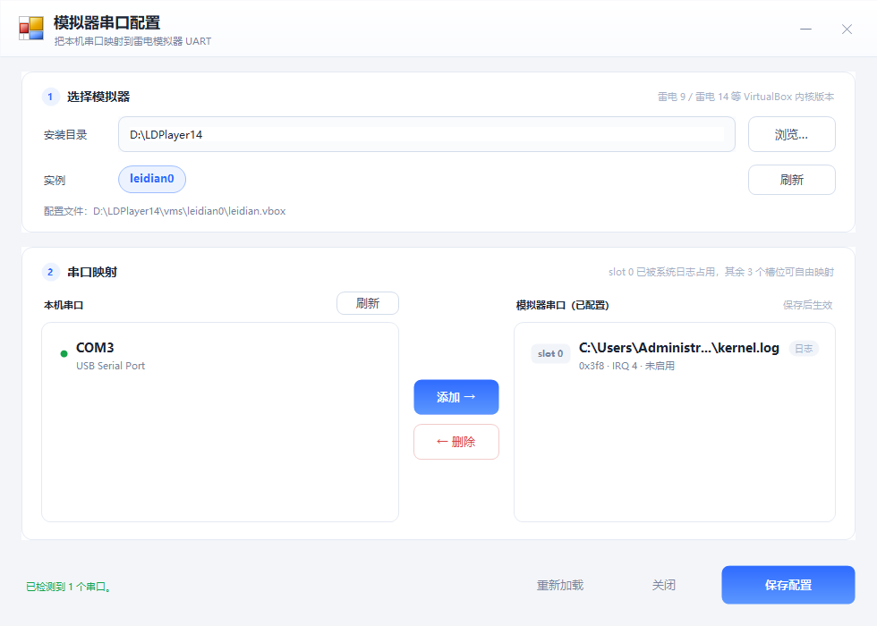

# 模拟器串口配置

一个给**雷电模拟器**（LDPlayer 9 / 14 等基于 VirtualBox 内核的版本）配置**物理串口映射**的小工具：
把本机的 `COM1`、`COM3` 之类的串口，映射成模拟器内部的 UART 口，让模拟器里的程序能直接打开串口设备。

绿色单文件 exe，无需安装、无需附带 DLL。



---

## 功能

- **自动探测**模拟器安装目录（运行中的进程 → 注册表 → 常见路径逐级查找），也可手动「浏览…」选择
- 自动列出 `vms\leidian0`、`leidian1`… 等**多开实例**，点选即可切换
- 后台读取本机串口，显示 `COM3 / USB Serial Port` 这样的设备名，已映射的会标「已映射」
- **添加 / 删除** UART 映射，自动分配空闲槽位（slot 1~3）与对应的 IOBase / IRQ
- 保存前若检测到模拟器在运行，会提示先关闭（否则退出时会把配置写回去覆盖掉）
- 保存后自动弹窗询问是否**启动 / 重启模拟器**让配置生效
- 保存时自动备份原文件，并把 `leidian.vbox` 设为**只读**，防止模拟器启动时覆盖

---

## 快速开始

1. 双击 `dist\模拟器串口配置.exe`
   > 打过包给别人的话，直接把这一个 exe 拷到对方电脑即可。
2. 确认「安装目录」正确（例如 `D:\LDPlayer14`，目录内应有 `dnplayer.exe`），不对就点「浏览…」重选
3. 有多个实例时，在「实例」那一行点选要配置的实例（如 `leidian1`）
4. 左侧「本机串口」选中要映射的串口 → 点「添加 →」
5. 点右下角「保存配置」
6. 弹窗问是否启动/重启模拟器 → 选「是」

> 若提示找不到 `leidian.vbox`：**先手动启动一次模拟器**（首次启动才会在 `vms\leidian0\` 下生成该文件），再回到工具点「刷新」。

---

## 关于只读保护（重要）

雷电模拟器在退出/启动时会重写 `leidian.vbox`，刚配好的串口映射会被冲掉。
所以本工具在**保存成功后会自动把该文件设为只读**。

- 工具再次保存时会自动临时解除只读，写完立刻加回，不会失败
- 界面上会显示「配置文件（只读保护）：…」并标绿
- **如果模拟器因为文件只读而启动失败**（个别版本会这样），取消只读即可，二选一：
  - 右键文件 → 属性 → 取消勾选「只读」→ 确定
  - 命令行：`attrib -R "D:\LDPlayer14\vms\leidian0\leidian.vbox"`

---

## 配置文件改了什么

目标文件：`<安装目录>\vms\leidianN\leidian.vbox`（XML 格式）。

默认只有一个系统日志口：

```xml
      <UART>
        <Port slot="0" enabled="false" IOBase="0x3f8" IRQ="4" path="C:\Users\Administrator\AppData\Roaming\ChangZhi2\kernel.log" hostMode="RawFile"/>
      </UART>
```

添加一个 COM3 映射后：

```xml
      <UART>
        <Port slot="0" enabled="false" IOBase="0x3f8" IRQ="4" path="C:\Users\Administrator\AppData\Roaming\ChangZhi2\kernel.log" hostMode="RawFile"/>
        <Port slot="1" enabled="true" IOBase="0x2f8" IRQ="3" path="COM3" hostMode="HostDevice"/>
      </UART>
```

槽位与端口地址的对应关系（工具自动填写）：

| slot | IOBase | IRQ | 说明 |
|------|--------|-----|------|
| 0 | 0x3f8 | 4 | 系统日志（RawFile），工具不允许删除 |
| 1 | 0x2f8 | 3 | 可映射 |
| 2 | 0x3e8 | 4 | 可映射 |
| 3 | 0x2e8 | 3 | 可映射 |

**写入方式**：只对 `<UART>` 标签内部做文本级替换，其余内容一个字节都不动
（保留原文件的缩进、斜杠风格、换行符 LF/CRLF、BOM 与编码；未修改的 Port 行原样写回）。
已验证：添加一行后再删掉，文件 MD5 与原始文件完全一致。

写盘前会在同目录生成备份：`leidian.vbox.bak-yyyyMMdd-HHmmss`。

---

## 从源码构建

### 一键构建

双击项目根目录的 **`build.bat`**，产物在 `dist\模拟器串口配置.exe`。

脚本会：

- 依次查找 `%SystemRoot%\Microsoft.NET\Framework64\v4.0.30319\csc.exe` 与 32 位版本
- 带上 `src\app.ico` 和 `src\app.manifest` 编译
- 成功显示文件大小，失败给出具体原因（含「exe 正在运行，请先关闭」的提示）

### 环境要求

只需要 **.NET Framework 4.x**（Win10 / Win11 / Win8.1 系统自带，无需安装 SDK 或 Visual Studio）。

- 编译器：`C:\Windows\Microsoft.NET\Framework64\v4.0.30319\csc.exe`
- 运行时：同一套 .NET Framework，因此**能编译的机器一定能运行**
- 老系统（如 Win7 SP1）若没有，装 [.NET Framework 4.8 运行时](https://dotnet.microsoft.com/download/dotnet-framework/net48) 即可

### 手动编译

```bat
"%SystemRoot%\Microsoft.NET\Framework64\v4.0.30319\csc.exe" /target:winexe /platform:anycpu /optimize+ ^
  /out:dist\模拟器串口配置.exe ^
  /win32icon:src\app.ico /win32manifest:src\app.manifest ^
  /r:System.dll /r:System.Core.dll /r:System.Drawing.dll ^
  /r:System.Windows.Forms.dll /r:System.Xml.dll /r:System.Management.dll ^
  src\Program.cs
```

> 源码是 **C# 5** 语法（该编译器不支持插值字符串、`?.`、表达式体成员等 C# 6+ 特性），改代码时注意。

---

## 目录结构

```
映射串口/
├─ build.bat                 一键构建脚本（GBK 编码，双击运行）
├─ dist/
│  └─ 模拟器串口配置.exe      构建产物（唯一需要分发的文件）
├─ src/
│  ├─ Program.cs             全部源码（界面 + vbox 读写 + 串口枚举）
│  ├─ app.manifest           DPI 感知（PerMonitorV2）与 asInvoker 权限
│  ├─ app.ico                程序图标
│  ├─ make_icon.py           用 Pillow 重新生成 app.ico
│  └─ gen_bat.py             用 GBK 重新生成 build.bat（改提示文字时用）
└─ 界面预览.png
```

---

## 隐藏参数（自检用，正常使用不需要）

| 参数 | 作用 |
|------|------|
| `--shot <图片路径>` | 离屏启动并截图（画到 PNG），用于改 UI 后自检 |
| `--dir <目录> --shot <图片路径>` | 指定安装目录再截图，便于用假目录预览多实例界面 |
| `--test <源vbox> <目标vbox> [add\|del]` | 读写往返测试：加载源文件，加一个 COM3 映射（或删掉最后一个）后另存到目标文件，不修改源文件 |

例：`模拟器串口配置.exe --test a.vbox b.vbox add`，然后 `diff a.vbox b.vbox` 应该只多一行 `<Port .../>`。

---

## 常见问题

**Q：点刷新提示找不到 `leidian.vbox`？**
先手动启动一次模拟器，让它在 `安装目录\vms\leidian0\` 下生成该文件，再回来刷新。

**Q：保存时提示「拒绝访问」/「另一个程序正在使用此文件」？**
有模拟器进程没退干净。到任务管理器结束 `dnplayer.exe`、`LdVBoxHeadless.exe`（或 `Ld9BoxHeadless.exe`）后重试；工具在保存前也会主动询问并帮你关。

**Q：保存后启动模拟器报错 / 起不来？**
多半就是只读属性导致的，按上面「关于只读保护」取消只读再试。

**Q：添加后模拟器里还是打不开串口？**
1. 确认改的是**正在使用的那个实例**（多开时每个实例的 vbox 是独立的）
2. 确认保存后**重启过**模拟器
3. 确认这个 COM 口没有被其他程序（串口助手、另一个模拟器实例等）占用
4. `hostMode="HostDevice"` 表示直通宿主机设备，模拟器内一般看到的是 `/dev/ttyS1` 这类设备节点

**Q：插了 USB 转串口，列表里没有？**
先装好驱动（设备管理器里能正常显示 COM 口），再点「刷新」。

**Q：能映射超过 3 个串口吗？**
VirtualBox 的 UART 只有 4 个槽位，slot 0 被系统日志占用，所以最多 3 个。

---

## 已知限制

- 不支持在工具内直接修改已有映射的 COM 口（先删再加即可）
- 只处理 UART，不动其他硬件配置
- 修改后需要重启模拟器才生效
